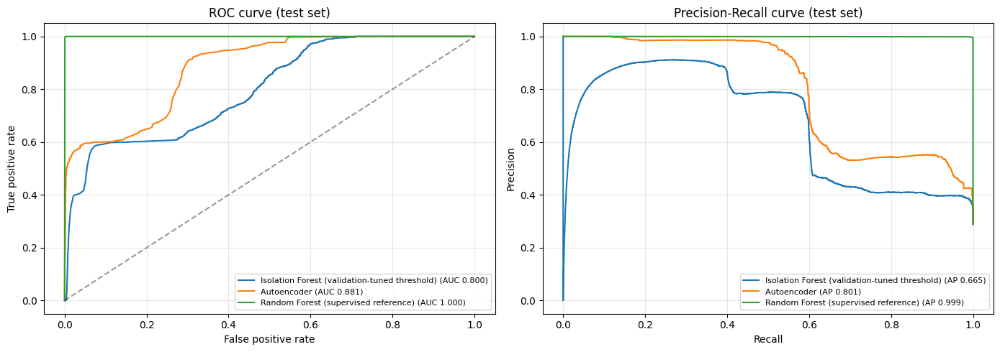
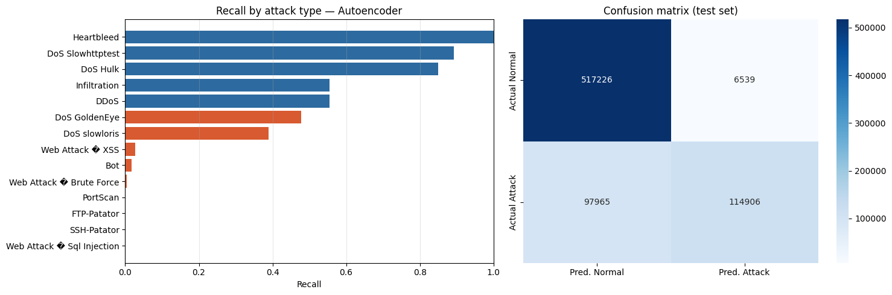

# AI-Powered Network Anomaly Detection

Unsupervised detection of malicious network traffic on the **CICIDS2017** dataset, trained on normal traffic only. Built with Python, scikit-learn and an IBM Garage-style development methodology.

## Overview

Most network attacks are rare and constantly changing, so labeled attack data is hard to get. This project trains models on **normal traffic only** and flags anything that deviates from it as a possible attack.

Two unsupervised models are compared, with a supervised Random Forest as a reference upper bound:

| Model | Trained on | Idea |
|---|---|---|
| Isolation Forest | Normal traffic only | Anomalies are isolated in fewer random splits |
| Autoencoder | Normal traffic only | Attacks reconstruct poorly, so reconstruction error is high |
| Random Forest (reference) | Normal and labeled attack traffic | Shows what is possible when labels are available |

## Dataset

- **CICIDS2017** (Canadian Institute for Cybersecurity): about 2.5M network flows after cleaning (infinite values, nulls and duplicates removed), 78 features, 14 attack types.
- The dataset is too large for this repository. Download it from the [CIC website](https://www.unb.ca/cic/datasets/ids-2017.html) and place the cleaned file at `MyDrive/CICIDS2017/cleaned_data.parquet` if you run it in Colab.

## Method

1. **Cleaning:** remove infinite values, nulls and duplicate rows. Binary label: BENIGN = 0, any attack = 1.
2. **Split with no overlap:**
   - Normal traffic: 60% train, 15% validation, 25% test.
   - Attack traffic: 40% train (used only by the supervised reference), 10% validation, 50% test.
3. **Feature cleanup (fit on training data only):** remove 8 constant features and 27 highly correlated features (|r| > 0.95), going from 78 to 43 features. Standard scaling with outlier clipping.
4. **Training:** Isolation Forest and the autoencoder train on normal training traffic only.
5. **Threshold selection:** the decision threshold is chosen on the validation set (best F1), not fixed in advance. ROC-AUC and PR-AUC are also reported because they don't depend on a threshold.
6. **Evaluation:** results are reported once on the held-out test set (736,636 flows, 29% attacks), including recall per attack type.

## Results (test set)

| Model | ROC-AUC | PR-AUC | Precision | Recall | F1 | False alarm rate |
|---|---|---|---|---|---|---|
| Isolation Forest (original fixed threshold) | 0.800 | 0.665 | 0.592 | 0.602 | 0.597 | 16.9% |
| Isolation Forest (validation-tuned threshold) | 0.800 | 0.665 | 0.780 | 0.569 | 0.658 | 6.5% |
| **Autoencoder** | **0.881** | **0.801** | **0.946** | 0.540 | **0.687** | **1.2%** |
| Random Forest (supervised reference) | 1.000 | 0.999 | 0.998 | 0.996 | 0.997 | 0.1% |

The autoencoder is the best unsupervised model. It keeps recall at a similar level while cutting false alarms from about 17% to about 1.2%.

### Recall by attack type (autoencoder)

- **Detected well:** DoS Slowhttptest (89%), DoS Hulk (85%), Heartbleed (5 of 5 flows).
- **Partly detected:** Infiltration (56%), DDoS (56%), DoS GoldenEye (48%), DoS slowloris (39%).
- **Mostly missed:** PortScan, FTP-Patator, SSH-Patator, Bot and the web attacks (XSS, brute force, SQL injection), at close to 0%.

## Limitations

- Recall is about 54%. Attacks that look like normal individual flows (port scans, brute-force logins) are hard for a model trained only on normal traffic.
- The supervised Random Forest reaches 0.997 F1, so the features separate the classes well when labels are available. The gap is a limit of the unsupervised approach, not the data.
- Results are from a single random split on one dataset. They are not a claim about performance on real-world traffic.

## Possible next steps

- Semi-supervised approach using a small amount of labeled attack data to improve recall on PortScan and brute-force attacks.
- Flow aggregation over time windows so repeated attempts from one source become visible.
- Compare more models (One-Class SVM, Local Outlier Factor, LSTM autoencoder).

## Repository contents

| Path | Description |
|---|---|
| `Network_Anomaly_Detection_Improved.ipynb` | Final notebook with clean split, threshold tuning, autoencoder and per-attack analysis (outputs included) |
| `Network_Anomaly_Detection_Project_Code (2).ipynb` | Original version (Isolation Forest, fixed threshold) |
| `results/` | Charts from the improved notebook |
| `*.pdf` | Project documents: project manual, solution architecture, technology stack, DFD and user stories, empathy map, brainstorming, project planning and performance testing |

## How to run

1. Open `Network_Anomaly_Detection_Improved.ipynb` in Google Colab (High-RAM runtime recommended).
2. Make sure `cleaned_data.parquet` is in `MyDrive/CICIDS2017`, or change `DATA_DIR` in the second cell.
3. Run all cells. Results are saved back to the same folder.

## Tech stack

Python, pandas, NumPy, scikit-learn (Isolation Forest, MLP autoencoder, Random Forest), matplotlib, seaborn, Google Colab, IBM Cloud.
